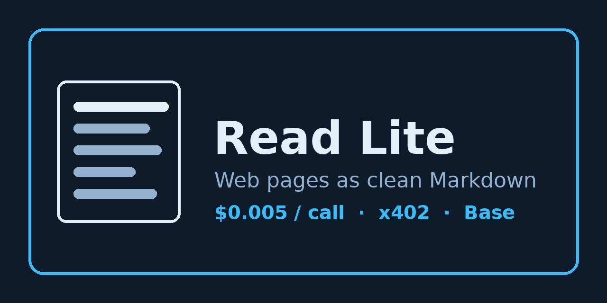

# @thewinnerscircle/plugin-read-lite

Read Lite for ElizaOS — fetch any web page as clean Markdown, paid per call via x402. The low-cost read tier built for high-volume agent loops.



## What it does

One action, **READ_URL_LITE**: when the agent needs the text of a page, it calls Read Lite and gets the page back as clean Markdown — nothing else. No search, no synthesis, no extra providers.

```
POST https://x402-web-reader.vercel.app/api/read-lite
Body: { "url": "https://example.com/article" }
Price: $0.005/call, USDC on Base via x402 — no API key
```

- `url` — the web page URL to fetch and convert to Markdown (required)

Returns: `url` (final URL after redirects), `title`, `excerpt` (may be `null`), `markdown` (the page's clean Markdown), and `wordCount`. Extraction uses the same pipeline as the full WebReader (Readability + Turndown, with a managed fallback) — articles and docs come back as tidy Markdown, not raw HTML. If a page can't be extracted, the endpoint returns HTTP 502 and the call is **never charged**.

## Why the lite tier

At half a cent per read, READ_URL_LITE is priced for loops: crawlers, monitors, research sweeps, and agents that read dozens or hundreds of pages per run. For a single page with search and synthesis on top, use the full WebReader (`/api/read`, $0.02/call); for raw page text at loop scale, use this.

## Install

```bash
npm i @thewinnerscircle/plugin-read-lite
# or: elizaos plugins add @thewinnerscircle/plugin-read-lite
```

Add to your character:

```json
{ "plugins": ["@thewinnerscircle/plugin-read-lite"] }
```

## Configuration

| Setting | Required | Notes |
|---|---|---|
| `EVM_PRIVATE_KEY` | yes | Wallet holding a small, capped USDC float on Base. Each read pays exactly $0.005 via `@x402/fetch` (exact scheme, CDP facilitator — gas-free for the payer). Cap the float: that is your spend limit. |

## Programmatic use

The plugin also exports a convenience helper for code that wants the page directly:

```ts
import { fetchPageMarkdown } from "@thewinnerscircle/plugin-read-lite";

const page = await fetchPageMarkdown("https://example.com/article", process.env.EVM_PRIVATE_KEY!);
// page: { url, title, excerpt, markdown, wordCount }
```

## Example

> User: Read https://example.com/article and summarize it
> Agent: Read https://example.com/article — "Example Article" (842 words) … *(full Markdown follows)*

## Discovery

Endpoint is cataloged in the Coinbase x402 Bazaar. `/.well-known/x402`, OpenAPI and an A2A agent card are published at https://x402-web-reader.vercel.app

Sibling plugins: `@thewinnerscircle/plugin-token-verdict` — pre-trade Base token safety check ($0.02/call); `@thewinnerscircle/plugin-deal-verdict` — pre-checkout deal check ($0.01/call). Same pattern, same wallet setup.

## License

MIT
